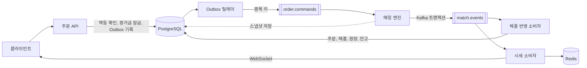

# 하루거래소 (Haru Exchange)

> 서버가 체결 도중 죽어도 돈과 주식은 1원, 1주도 틀어지지 않고 호가창은 똑같이 복원된다.

하루거래소(가칭)는 반도체·방산·조선·원자력·식품·엔터·자동차·항공우주 업종의 가상 기업 8개가 상장된 시장에서 주문, 체결, 잔고, 결제까지 처리하는 Spring 백엔드 포트폴리오 프로젝트입니다. 금융 상품을 늘리기보다 트랜잭션, 동시성, 메시징, 장애 복구를 깊게 다루고 그 결과를 측정으로 증명하는 것을 목표로 합니다.

> **모든 종목과 자금은 가상이며 투자 권유가 아닙니다.** 실제 시세, 계좌, 결제와 연결하지 않습니다.

## 현재 상태

**초기 설정 단계입니다.** 아직 거래 기능은 구현되지 않았으며, 이 문서의 기능과 수치는 모두 설계 내용과 목표값입니다.

| 기간 목표 | 완료 기준 | 상태 |
| --- | --- | --- |
| 4주 차 | 무작위 주문열에서 체결 불변식과 결정성 테스트 통과 | 예정 |
| 8주 차 | 동시 주문에서 음수 잔고 0건, 원장 합계 0 확인 | 예정 |
| 12주 차 | 체결 중 강제 종료 후 호가창 해시 일치, 중복 반영 0건 | 예정 |
| 16주 차 | 주문 100만 건 대사 차이 0, README와 데모 GIF 공개 | 예정 |

## 지켜야 할 다섯 가지 불변식

1. 가용·잠금 현금과 주식은 음수가 될 수 없다.
2. 같은 주문 명령은 두 번 체결되지 않는다.
3. 누적 체결 수량은 주문 수량을 넘지 않는다.
4. 수수료 계정을 포함한 시스템 전체의 현금과 종목별 주식 총량은 거래 전후 같다.
5. 같은 명령 로그를 재생하면 항상 같은 체결 결과가 나온다.

## 목표 지표

로컬 Docker 환경 기준의 목표값이며, 5주 차 기준선 측정 후 조정합니다.

- 주문 100만 건 실행 후 현금과 주식 총량 차이 0
- 음수 잔고, 중복 체결, 초과 체결 0건
- 체결 중 강제 종료 후 복구한 호가창 해시 100% 일치
- 같은 주문 로그를 다시 실행하면 같은 체결 결과
- 매칭 엔진 단독 처리량 종목당 초당 50,000건 이상
- 주문 접수부터 체결 이벤트까지 p99 300ms 이하

## MVP 범위

| 구분 | 포함 | 제외 |
| --- | --- | --- |
| 상품 | 가상 현물 주식 8종목 | ETF, 채권, 선물, 옵션 |
| 주문 | 지정가, 시장가, 정정, 취소 | 스톱, FOK, 알고리즘 주문 |
| 신용 | 보유 현금·주식 범위 내 거래 | 미수, 신용거래, 공매도 |
| 장 운영 | 연속 매매, 상·하한가, 종목 정지 | 시간외 거래, 단일가 매매 |
| 시세 | 봇이 만드는 가상 시세 | 실제 시세 연동 |
| 자금 | 가상 원화, 수수료 | 실계좌, 실제 결제, 세금 |
| 인증 | 이메일 로그인, JWT, 역할 권한 | 본인 인증, 소셜 로그인 |
| 구조 | 모듈형 모놀리스 | MSA, Kubernetes, 다중 리전 |

## 아키텍처

매칭 엔진은 DB 락을 쓰지 않는 종목별 단일 스레드 메모리 엔진입니다. 잔고 정합성은 PostgreSQL이, 순서와 복구는 Kafka 명령 로그가 책임집니다.

### 주문 처리

1. API가 한 트랜잭션에서 멱등 확인, 증거금 잠금, 주문 저장, Outbox 기록을 처리합니다.
2. 릴레이가 명령을 종목 키로 `order.commands`에 발행해 종목별 순서를 고정합니다.
3. 엔진이 명령을 순서대로 매칭하고, 입력 오프셋 커밋과 `match.events` 발행을 Kafka 트랜잭션으로 묶습니다.
4. 체결 반영 소비자가 한 DB 트랜잭션에서 주문, 체결, 원장, 잔고를 갱신합니다. `(symbol, match_seq)` 유니크 제약으로 중복 반영을 막습니다.
5. 시세 소비자가 Redis와 WebSocket으로 호가·체결을 전달합니다. 시세 장애는 주문 처리를 막지 않습니다.

### 장애 복구

1. 엔진이 1분 또는 10,000건마다 호가 스냅샷과 입력 오프셋을 저장합니다.
2. 재시작하면 최신 스냅샷을 읽고 그 이후 명령을 재생합니다.
3. 재생 중 이미 발행한 이벤트는 `match_seq`로 걸러냅니다.
4. 호가창 해시를 검증한 뒤 신규 명령 처리를 재개합니다.

## 주요 거래 규칙

아래 수치는 실제 거래소 규정이 아니라 이 프로젝트의 가상 규칙입니다.

- **체결:** 가격 우선, 시간 우선으로 매칭하고 먼저 대기하던 주문의 가격으로 체결합니다.
- **금액:** `double`을 쓰지 않고 정수 원(`long`, `BIGINT`)으로 처리합니다.
- **멱등성:** 모든 주문은 `Idempotency-Key`를 사용합니다.
- **자전거래 방지:** 같은 계좌의 매수·매도가 만나면 새 주문의 남은 수량을 취소합니다.
- **가격 제한:** 상·하한가는 전일 종가 대비 ±30%입니다.
- **서킷브레이커:** 1분 안에 ±10% 이상 움직이면 2분간 신규 체결을 정지합니다.
- **수수료:** 매수·매도 각 0.015%이며 1원 미만은 올림합니다.
- **결제:** 체결 즉시 복식 원장에 기록하고, 가상 영업일 기준 T+2에 배치로 확정합니다.
- **원장:** 수정하지 않으며 오류는 역분개로만 바로잡습니다.
- **대사:** 장 마감 후 불일치가 있으면 다음 개장을 막습니다.

## 기술 스택

| 영역 | 선택 |
| --- | --- |
| 언어·프레임워크 | Java 25, Spring Boot 4.2 |
| 매칭 엔진 | Spring 없는 순수 Java 모듈 |
| 데이터 접근 | Spring Data JPA, QueryDSL |
| DB | PostgreSQL, Flyway |
| 메시징 | Kafka |
| 캐시·실시간 | Redis, WebSocket |
| 배치 | Spring Batch |
| 모듈 경계 | Spring Modulith |
| 테스트 | JUnit 5, jqwik, Testcontainers |
| 성능·관측 | JMH, k6, Prometheus, Grafana |

## 검증 계획

- **성능 비교:** 호가 자료구조, 매칭 동시성, 잔고 잠금 방식을 같은 환경에서 각 3회 실행해 중앙값을 기록합니다.
- **속성 기반 테스트:** jqwik으로 무작위 주문열을 생성해 다섯 가지 불변식을 검증합니다.
- **결정성 테스트:** 같은 명령 로그를 두 번 실행해 이벤트와 호가창 해시를 비교합니다.
- **통합 테스트:** PostgreSQL, Redis, Kafka를 Testcontainers로 실행합니다.
- **장애 실험:** 엔진 강제 종료, 스냅샷 손상, DB·Kafka·Redis 중단, 이벤트 중복 전달, 배치 중단을 검증합니다.

## 실행 방법

거래 기능 구현 후 `docker compose up` 한 번으로 데모를 실행할 수 있도록 구성할 예정입니다.
