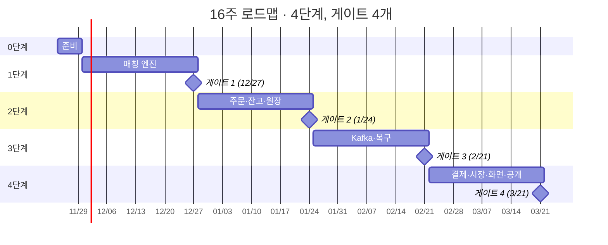

# 하루거래소 WBS

> 원본: [Claude Docs · 하루거래소 WBS](https://claude.ai/artifact/CVZatqAV2UNufrSBUVJQKB) (2026-11-24 기준, rev 8)
> 이 파일은 계획과 원칙을 담는 기준 문서입니다. **진행 상황은 [GitHub Issues](https://github.com/seungmin4452-spec/haru-exchange/issues)와 [Milestones](https://github.com/seungmin4452-spec/haru-exchange/milestones)에서 체크합니다.**
> 계획을 바꾸면 이 파일과 해당 이슈를 함께 고칩니다.

## 한눈에 보기

**2026년 11월 30일부터 2027년 3월 21일까지 16주 동안, 주 12시간으로 4단계를 진행한다.** 각 단계는 마지막 주의 게이트를 통과해야 다음으로 넘어간다. 그 전에 이번 주(11/24~11/29) 안에 0단계 준비를 끝낸다.

작업 번호는 `단계.순번`이다. 주차는 월요일에 시작한다. 주차마다 이슈가 하나씩 있고, 커밋 메시지에 `#이슈번호`를 붙여 연결한다.

| 단계 | 기간 | 게이트 (완료 기준) |
| --- | --- | --- |
| [0. 준비](https://github.com/seungmin4452-spec/haru-exchange/milestone/1) | 11/24~11/29 | 개발 환경 고정 |
| [1. 매칭 엔진](https://github.com/seungmin4452-spec/haru-exchange/milestone/2) | 1~4주 (11/30~12/27) | 무작위 주문열에서 체결 불변식과 결정성 테스트 통과 |
| [2. 주문·잔고·원장](https://github.com/seungmin4452-spec/haru-exchange/milestone/3) | 5~8주 (12/28~1/24) | 동시 주문에서 음수 잔고 0건, 원장 합계 0 확인 |
| [3. Kafka·복구](https://github.com/seungmin4452-spec/haru-exchange/milestone/4) | 9~12주 (1/25~2/21) | 체결 중 강제 종료 후 호가창 해시 일치, 중복 반영 0건 |
| [4. 결제·시장·화면·공개](https://github.com/seungmin4452-spec/haru-exchange/milestone/5) | 13~16주 (2/22~3/21) | 주문 100만 건 대사 차이 0, README와 데모 GIF 공개 |

## 0단계 준비 · 11/24~11/29

**시작 전 이번 주에 개발 환경을 고정해, 1주 차부터 바로 엔진 코드에 들어간다.** → [#1](https://github.com/seungmin4452-spec/haru-exchange/issues/1)

- 0.1 `compose.yaml`에 Kafka를 추가하고 PostgreSQL·Redis 이미지를 `latest` 대신 버전으로 고정
- 0.2 Spring Modulith `2.2.0-M1` 마일스톤 버전을 유지할지 결정
- 0.3 매칭 엔진을 Spring 없는 Gradle 하위 모듈로 분리
- 0.4 jqwik, JMH, QueryDSL을 Gradle에 직접 추가
- 0.5 GitHub Actions에 빌드·테스트 CI 추가
- 0.6 `docs/adr` 폴더와 ADR 템플릿 작성
- 0.7 가상 기업 8개 이름 확정, 실존 기업·상표와 겹치는지 확인

## 1단계 매칭 엔진 · 1~4주 (11/30~12/27)

**Spring 없이 동작하는 결정적 매칭 엔진을 만들고, 무작위 주문열에서 불변식과 결정성 테스트를 통과시킨다.** 엔진은 4주를 넘기지 않는다.

### 1주 차 · 11/30~12/6 → [#2](https://github.com/seungmin4452-spec/haru-exchange/issues/2)

- 1.1 다섯 가지 불변식과 실패 시나리오를 직접 먼저 작성
- 1.2 주문·명령·이벤트 타입 정의 (가격과 금액은 `long`)
- 1.3 호가 단위와 상·하한가(전일 종가 ±30%) 검증
- 1.4 ADR-001 종목별 단일 스레드 엔진

### 2주 차 · 12/7~12/13 → [#3](https://github.com/seungmin4452-spec/haru-exchange/issues/3)

- 1.5 `TreeMap` + `ArrayDeque` 호가창 구현
- 1.6 지정가 매칭: 가격 우선, 시간 우선, 대기 주문 가격으로 체결
- 1.7 부분 체결과 누적 체결 수량 관리
- 1.8 종목별 `match_seq` 발급

### 3주 차 · 12/14~12/20 → [#4](https://github.com/seungmin4452-spec/haru-exchange/issues/4)

- 1.9 시장가 주문과 남은 수량 즉시 취소
- 1.10 취소와 정정 (가격 변경·수량 증가는 우선순위 상실)
- 1.11 자전거래 방지
- 1.12 엔진이 시스템 시계 대신 명령의 시각만 사용하도록 정리

### 4주 차 · 12/21~12/27 → [#5](https://github.com/seungmin4452-spec/haru-exchange/issues/5)

- 1.13 호가창 해시 함수
- 1.14 jqwik 속성 테스트: 무작위 주문열에서 중복·초과 체결 0건
- 1.15 결정성 테스트: 같은 명령 로그 두 번 실행 후 이벤트와 해시 비교
- 1.16 경계 케이스 보강, 엔진 모듈 리팩터링

**게이트 (12/27):** 무작위 주문열에서 체결 불변식과 결정성 테스트 통과

## 2단계 주문·잔고·원장 · 5~8주 (12/28~1/24)

**엔진을 Spring 주문 경로에 연결하고, 동시 주문에도 잔고와 원장이 틀어지지 않음을 증명한다.** 이 단계에서는 Kafka 없이 애플리케이션 안에서 엔진을 호출한다.

### 5주 차 · 12/28~1/3 → [#6](https://github.com/seungmin4452-spec/haru-exchange/issues/6)

- 2.1 실험 1: 호가 자료구조 3종 JMH 비교
- 2.2 엔진 단독 처리량 기준선 측정, 성공 기준 목표값 조정
- 2.3 Flyway 스키마: `instrument`, `account`, `cash_balance`, `position`, `orders`와 CHECK·UNIQUE 제약
- 2.4 가상 종목 8개, 고객·봇·수수료 계좌 초기 데이터

### 6주 차 · 1/4~1/10 → [#7](https://github.com/seungmin4452-spec/haru-exchange/issues/7)

- 2.5 이메일 로그인, JWT, 역할 권한
- 2.6 주문 접수 API와 `Idempotency-Key` 처리
- 2.7 주문 유형별 증거금 잠금 (후보: 조건부 `UPDATE`)
- 2.8 주문 정정·취소 API

### 7주 차 · 1/11~1/17 → [#8](https://github.com/seungmin4452-spec/haru-exchange/issues/8)

- 2.9 실험 3: 잔고 잠금 4가지 방식 비교, ADR 작성
- 2.10 복식 원장: `journal`, `journal_line`, 역분개
- 2.11 체결 반영: 주문·체결·원장·잔고를 한 트랜잭션으로 갱신
- 2.12 수수료 0.015% 올림, 유리한 체결가의 차액 잠금 해제

### 8주 차 · 1/18~1/24 → [#9](https://github.com/seungmin4452-spec/haru-exchange/issues/9)

- 2.13 조회 API: 종목, 내 주문, 잔고와 보유 종목 (QueryDSL)
- 2.14 N+1 개선 전후 쿼리 수 측정
- 2.15 같은 계좌에 잔고보다 많은 동시 주문 1,000건 테스트
- 2.16 모든 경로 테스트 끝에 자산별 원장 합계 0 검증
- 2.17 Spring Modulith 모듈 의존 규칙을 CI에 추가

**게이트 (1/24):** 동시 주문에서 음수 잔고 0건, 원장 합계 0 확인

## 3단계 Kafka·복구 · 9~12주 (1/25~2/21)

**엔진을 Kafka 명령 로그 뒤로 옮기고, 체결 중 강제 종료해도 호가창이 그대로 복원됨을 증명한다.** 가장 어려운 단계라서 9주 차에 단일 종목 프로토타입부터 만든다.

### 9주 차 · 1/25~1/31 → [#10](https://github.com/seungmin4452-spec/haru-exchange/issues/10)

- 3.1 단일 종목 복구 프로토타입: 스냅샷 + 명령 재생
- 3.2 `outbox_event` 테이블과 주문 트랜잭션 안의 Outbox 기록
- 3.3 Outbox 릴레이: 종목 키로 `order.commands` 발행
- 3.4 ADR: 명령 로그와 Outbox

### 10주 차 · 2/1~2/7 → [#11](https://github.com/seungmin4452-spec/haru-exchange/issues/11)

- 3.5 엔진 Kafka 소비자, 종목별 단일 처리기
- 3.6 입력 오프셋 커밋과 `match.events` 발행을 Kafka 트랜잭션으로 묶기
- 3.7 체결 반영 소비자를 Kafka로 전환, `(symbol, match_seq)` 중복 차단
- 3.8 반복 실패 메시지 DLQ

### 11주 차 · 2/8~2/14 → [#12](https://github.com/seungmin4452-spec/haru-exchange/issues/12)

- 3.9 스냅샷 저장: 1분 또는 10,000건마다 `engine_snapshot`
- 3.10 재시작 복구: 최신 스냅샷 로드, 이후 명령 재생, 발행된 이벤트 걸러내기
- 3.11 호가창 해시 검증 후 신규 명령 재개
- 3.12 실험 2: 매칭 동시성 3가지 방식 비교

### 12주 차 · 2/15~2/21 → [#13](https://github.com/seungmin4452-spec/haru-exchange/issues/13)

- 3.13 Testcontainers로 PostgreSQL·Kafka 통합 테스트
- 3.14 장애 실험: 체결 중 엔진 강제 종료, 스냅샷 손상
- 3.15 장애 실험: 체결 반영 중 DB 중단, Kafka 브로커 중단, 이벤트 중복 전달
- 3.16 장애 실험 기록: 주입 절차, 기대 결과, 실제 결과

**게이트 (2/21):** 체결 중 강제 종료 후 호가창 해시 일치, 중복 반영 0건

## 4단계 결제·시장·화면·공개 · 13~16주 (2/22~3/21)

**결제와 대사로 한 바퀴를 닫고, 측정 결과와 데모를 공개한다.** 프론트엔드는 15~16주 차 2주로 제한하고, 축소 대상은 표시해 두었다.

### 13주 차 · 2/22~2/28 → [#14](https://github.com/seungmin4452-spec/haru-exchange/issues/14)

- 4.1 시세 소비자: Redis 호가·시세·캔들 캐시
- 4.2 WebSocket `/ws/market/{symbol}`, `/ws/me/orders`
- 4.3 장 운영: 개장·마감, 마감 시 미체결 만료와 잠금 해제, 종목 정지
- 4.4 Spring Batch T+2 결제 (`settlement_instruction`)
- 4.5 장애 실험: Redis 중단, 결제 배치 중단 후 재시작

### 14주 차 · 3/1~3/7 → [#15](https://github.com/seungmin4452-spec/haru-exchange/issues/15)

- 4.6 일일 대사 배치, 불일치 시 다음 개장 차단
- 4.7 거래 봇: 호가 제시, 추세 추종, 무작위 주문
- 4.8 가상 뉴스 발행과 뉴스 반응 봇 (축소 대상)
- 4.9 종목 서킷브레이커 (축소 대상)
- 4.10 운영 API: 종목 정지, DLQ 재처리, 대사 재실행 (축소 대상)

### 15주 차 · 3/8~3/14 → [#16](https://github.com/seungmin4452-spec/haru-exchange/issues/16)

- 4.11 화면: 거래 화면, 시장 시뮬레이터, 장애 복구 화면
- 4.12 k6 부하 시나리오 5종 실행
- 4.13 Prometheus·Grafana 지연 시간과 소비 지연 대시보드

### 16주 차 · 3/15~3/21 → [#17](https://github.com/seungmin4452-spec/haru-exchange/issues/17)

- 4.14 화면: 내 자산, 주문 내역, 원장·대사 (운영 콘솔은 축소 대상)
- 4.15 주문 100만 건 실행 후 대사 차이 0 확인
- 4.16 `docker compose up` 한 번으로 데모 실행
- 4.17 성능 리포트와 ADR 10건 이상 정리
- 4.18 README 측정 결과 갱신과 장애 복구 30초 GIF

**게이트 (3/21):** 주문 100만 건 대사 차이 0, README와 데모 GIF 공개

## 지연 대응과 매주 반복 작업

**일정이 2주 이상 밀리면 운영 콘솔, 뉴스 반응 봇, 서킷브레이커 순으로 범위를 줄인다.** 매칭, 잔고, 원장, 복구는 줄이지 않는다. 게이트를 통과해야 다음 단계로 넘어간다.

매주 반복:

1. 이번 주 작업의 불변식, 트랜잭션 경계, 실패 시나리오를 먼저 작성한다.
2. Claude에게 설계 반박을 받고 작은 단위로 구현한다.
3. 속성 기반 테스트와 장애 실험으로 결과를 깨뜨려 본다.
4. 결정과 포기한 대안을 ADR로 남긴다.
5. 주말에 이 문서의 체크박스와 실제 투입 시간(주 12시간)을 확인한다.

완성 후 (3/22~): → [#18](https://github.com/seungmin4452-spec/haru-exchange/issues/18)

- 매칭 핵심과 Outbox를 AI 없이 한 번 다시 구현해 이해도 점검
- ADR과 재구현을 바탕으로 면접 답변 정리
